<p align="center">
  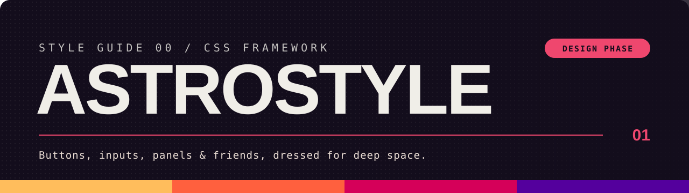
</p>

<p align="center">
  
  
  
  
</p>

<p align="center">
  <b>Buttons, inputs, pagination, panels and all the other bits a website needs,<br>
  dressed in the colors and attitude of the ASTROPRISMA tabletop RPG.</b><br>
  <sub>SCSS core · plain CSS build · a pinch of vanilla JavaScript · no framework required</sub>
</p>

<p align="center">
  <a href="https://cantilux.github.io/astrostyle/">
    
  </a>
</p>

> [!IMPORTANT]
> **🛰️ Engines warming up.**
>
> **In place:** design tokens, light and dark themes, the Design Guide fonts that may be redistributed, the reset, element defaults, layout objects (stack, cluster, grid, sidebar, switcher, frame, container), utilities and the Sass toolbox.
>
> **Components:** buttons, button groups, fields, inputs, selects, a searchable combobox, checkboxes, radios, switches, ranges, segmented meters, breadcrumbs, pagination, tabs, tags, callouts, progress bars, spinners, empty states, toasts, dialogs, drawers, accordions, tooltips, menus, tables, lists, dividers, key caps, skeletons, and the Design Guide's own blocks: mastheads, section headings, subheadings, windows, cards, tabbed boxes, segment bars, swatches and textured surfaces.
>
> **Next:** the road to `1.0.0`, one [milestone](https://github.com/Cantilux/astrostyle/milestones) per minor version: test infrastructure, size and tone scales, utilities, icons, more form, navigation and content components, then the API freeze, an accessibility audit, the browser matrix and a customization guide. The full list is in the [roadmap](https://github.com/Cantilux/astrostyle/issues/94). Until then, minor versions may still change the API.

> [!NOTE]
> astrostyle is an independent production by Enrico Cantile and is not affiliated with Crescent Chimera. It is published under the [ASTROPRISMA Third Party License](https://www.astroprisma.com/license).
>
> ASTROPRISMA is copyright Camila Mera and Crescent Chimera.

<br>

## 

```sh
npm install astrostyle
# or: bun add astrostyle · pnpm add astrostyle · yarn add astrostyle
```

<br>

### / With Sass (recommended) /

The Sass entry point gives you the whole toolbox and lets you configure everything at build time. Dart Sass 1.71 or newer is required.

```scss
@use 'pkg:astrostyle' as ap;   // or 'astrostyle' with Vite and other bundlers

@include ap.emit;               // tokens, themes, reset, elements, layouts, components, utilities
```

The `pkg:` URL needs Sass's Node package importer:

```js
import * as sass from 'sass'

sass.compile('style.scss', { importers: [new sass.NodePackageImporter()] })
```

<br>

### / Plain CSS /

No Sass? Use the precompiled stylesheet with the default configuration:

```html
<link rel="stylesheet" href="node_modules/astrostyle/dist/astrostyle.css">
```

```js
import 'astrostyle/css'        // bundlers: readable build
import 'astrostyle/css/min'    // bundlers: minified build
```

Only need a few components? Load the core, then just those components (each also as `.min`):

```js
import 'astrostyle/css/core'   // tokens, themes, reset, elements, layouts, utilities
import 'astrostyle/css/button'
import 'astrostyle/css/input'
```

```html
<link rel="stylesheet" href="node_modules/astrostyle/dist/core.css">
<link rel="stylesheet" href="node_modules/astrostyle/dist/components/button.css">
```

Every file declares the cascade layer order, so the load order of the files does not matter. `button-group` adjusts `button`, so load both.

<br>

### / JavaScript /

A few components get optional behavior from small, dependency-free ES modules. Without JavaScript they still work as native HTML. The modules ship TypeScript declarations (`dist/types/`), so `astrostyle/js` and `astrostyle/js/<component>` are typed with no extra install.

```js
import { autoInit } from 'astrostyle/js'

autoInit(document)   // select[data-ap-combobox] → searchable combobox,
                     // nav[data-ap-pagination] → pagination, [data-ap-tabs] → tabs,
                     // dialog[data-ap-dialog] → dialog or drawer with openers,
                     // [data-ap-menu] → menu button, [data-ap-tooltip] → tooltip
```

```js
import { createCombobox } from 'astrostyle/js/combobox'
import { createToaster } from 'astrostyle/js/toast'

const select = document.querySelector('#ship')
createCombobox(select, { creatable: true })
select.addEventListener('ap:change', (event) => console.log(event.detail))

const toaster = createToaster()
toaster.show({ title: 'Docked', message: 'All systems online.', tone: 'success' })
```

In TypeScript, every `createX()` factory, its options and its handle are typed:

```ts
import { createCombobox } from 'astrostyle/js/combobox'

const select = document.querySelector<HTMLSelectElement>('#ship')!
const combobox = createCombobox(select, { creatable: true })
combobox.setValue('falcon')  // string; getValue() returns a string
```

Each component module also exports its types by name, `<Name>Options` and `<Name>Handle` (`ComboboxOptions`, `TabsHandle`, `ToasterOptions`…), plus `ComboboxOption`, `ToastContent` and `Handle` (any handle `autoInit()` returns); `astrostyle/js` re-exports them all:

```ts
import type { TabsHandle } from 'astrostyle/js'
import type { DialogOptions } from 'astrostyle/js/dialog'
```

The declarations live in `dist/types/` and are found through the `types` condition of the package `exports`, so `tsconfig.json` needs `"moduleResolution": "bundler"` (`node16` and `nodenext` work too). The classic `node` resolution does not read `exports`, so the imports would stay untyped.

<br>

### / First flight /

```html
<html data-ap-theme="dark">     <!-- light is the default; pick a theme explicitly -->
  <body>
    <p style="color: var(--ap-accent)">Hello, spacefarer.</p>
  </body>
</html>
```

Every token is a CSS custom property (`--ap-accent`, `--ap-space-md`, `--ap-text-body-size`…), so your own CSS can use them right away. The full list, in the W3C Design Tokens format, ships as `astrostyle/tokens.json`.

<br>

### / Make it yours /

```scss
@use 'pkg:astrostyle' as ap with (
  $accent: #3fa7ff,                      // new accent, shades and ink derived for you
  $theme-default: 'dark',
  $scope: '.my-app',                     // keep everything inside one element
  $themes: (dark: (bg: #0c0812)),        // change one token of one theme
  $components: (button, input, select),  // emit only the components you use
  $emit-objects: false,                  // no layout classes (ap-o-*) if you lay out pages yourself
  $emit-utilities: false,                // no helper classes (ap-u-*) if you use none
);

@include ap.emit;

.my-widget {
  padding: ap.space(md);                 // tokens, checked at compile time
  border-radius: ap.token(radius-card);
  @include ap.text(label);               // a whole type role in one line
  @include ap.mq(md) { display: grid; }  // mobile-first media query
}
```

At runtime, any token can be overridden with plain CSS. astrostyle lives in cascade layers, so your styles always win:

```css
:root { --ap-radius-card: 8px; --ap-font-scale: 1.1; }
```

<br>

## 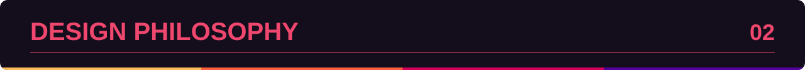

<br>

### The Design Guide is the captain

Everything starts from the **ASTROPRISMA Design Guide** (`06_Design Guide [PDF]`), included in the official ASTROPRISMA Creator Kit. When astrostyle and the guide disagree, **the guide wins**. The framework turns its print rules into screen-ready tokens and components.

<br>

### / Colors /

ASTROPRISMA Black is a **dark indigo**, never a flat black. The whites are **warm bone whites**, never pure white. Pink is the accent, and the guide openly invites you to swap it, so in astrostyle the accent is a single token you can change.

Every value below comes straight from the guide's vector artwork (sRGB).

<table>
  <tr>
    <th colspan="3">Core</th>
    <th colspan="3">Accent</th>
  </tr>
  <tr>
    <td></td><td>ASTROPRISMA Black</td><td><code>#130d1c</code></td>
    <td></td><td>ASTROPRISMA Pink</td><td><code>#ef476e</code></td>
  </tr>
  <tr>
    <td></td><td>ASTROPRISMA White</td><td><code>#f0eee8</code></td>
    <td></td><td>Dark Pink</td><td><code>#d50059</code></td>
  </tr>
  <tr>
    <td></td><td>ASTROPRISMA Off-White</td><td><code>#e9dcd3</code></td>
    <td></td><td>Shadow Pink</td><td><code>#ab0048</code></td>
  </tr>
</table>

<table>
  <tr>
    <th colspan="3">Gradient</th>
    <th colspan="3">Factions</th>
  </tr>
  <tr>
    <td></td><td>Yellow</td><td><code>#ffbd5c</code></td>
    <td></td><td>WARG Red</td><td><code>#ca2632</code></td>
  </tr>
  <tr>
    <td></td><td>Orange</td><td><code>#ff603e</code></td>
    <td></td><td>Intersolar Blue</td><td><code>#5fc3b0</code></td>
  </tr>
  <tr>
    <td></td><td>Magenta</td><td><code>#d50059</code></td>
    <td></td><td>Medusa Green</td><td><code>#6abd45</code></td>
  </tr>
  <tr>
    <td></td><td>Indigo</td><td><code>#54009d</code></td>
    <td></td><td>Wire Teal</td><td><code>#4bba7a</code></td>
  </tr>
  <tr>
    <td colspan="3"></td>
    <td></td><td>Corsair Yellow</td><td><code>#faa21e</code></td>
  </tr>
  <tr>
    <td colspan="3"></td>
    <td></td><td>Synth Magenta</td><td><code>#d51b5b</code></td>
  </tr>
</table>

<br>

### / Gradient /


Four colors, four equal bands, always in this order. **Hard edges only**: the gradient is never a soft blend.

<br>

### / Light & dark /

The guide uses both pairings: black on white and white on black. astrostyle ships **two complete themes**. You pick one with `data-ap-theme`; the framework never guesses from operating-system settings.

<br>

### / Typography /

| Font | Role in the guide | Token | Used by |
| --- | --- | --- | --- |
| **Feature Mono** | Main text: Light for body, Medium for bold, Hairline for details | `--ap-font-body` | Type roles `body`, `data`, `label`, `caption`, `action`; code |
| **Newake** *(paid)*, or **Powerr** *(free)* | Titles and the logo | `--ap-font-display` | Type roles `display`, `screen-title`, `panel-title` (`h1`–`h3`) |
| *Instrument Serif* | Italics and map labels | `--ap-font-serif` | `em`, `i`, `cite`, `blockquote` |
| **Rimma Sans**, **Free Fat Font**, **Genesys**, **ST-Cyberillic**, **SCHABO** | Special titles and graphic details | `--ap-font-accent-rimma`, `-fat`, `-genesys`, `-cyberillic`, `-schabo` | Nothing by default: put them where you need them, e.g. `font-family: var(--ap-font-accent-genesys)` |

Every token ends in system fonts, so a font that is not loaded falls back quietly. The [Foundations page](https://cantilux.github.io/astrostyle/foundations.html#fonts) shows a sample of each.

The fonts whose license allows redistribution ship in the package: **Feature Mono**, *Instrument Serif*, **Genesys** and **ST-Cyberillic**, each under its own license ([`fonts/README.md`](fonts/README.md)). The optional `astrostyle/fonts.css` declares them:

```js
import 'astrostyle/fonts.css'   // bundlers copy the font files for you
```

With Sass, point the faces to wherever your build serves the `fonts/` folder:

```scss
@use 'pkg:astrostyle/scss/fonts' with ($path: '/assets/fonts');
```

Newake, Powerr, Rimma Sans, SCHABO and Free Fat Font are **not bundled**: Newake is paid, and the others' licenses do not clearly allow redistribution. Bring your own files and the tokens pick them up; for Powerr, Rimma Sans and SCHABO, `$licensed-path` adds the faces too (file names in [`fonts/README.md`](fonts/README.md)):

```scss
@use 'pkg:astrostyle/scss/fonts' with ($path: '/assets/fonts', $licensed-path: '/assets/own-fonts');
```

<br>

### / Texture & motifs /

- **Halftone and noise.** The guide's print filters (halftone dots, a fine grain) become the optional `ap-c-surface` for decorative areas, behind headings and art, never under forms or long text.
- **Graphic motifs → components.** The big masthead with its tiny eyebrow, the pink section heading with a hairline rule and a two-digit index (like the ones in this README), the window panel with its inverted title bar, rounded cards and swatch tiles, pill buttons, segmented pill legends, side-tab boxes, callouts and `/ SLASHED /` subheadings.

<br>

### The principles, in short

<p align="center">
  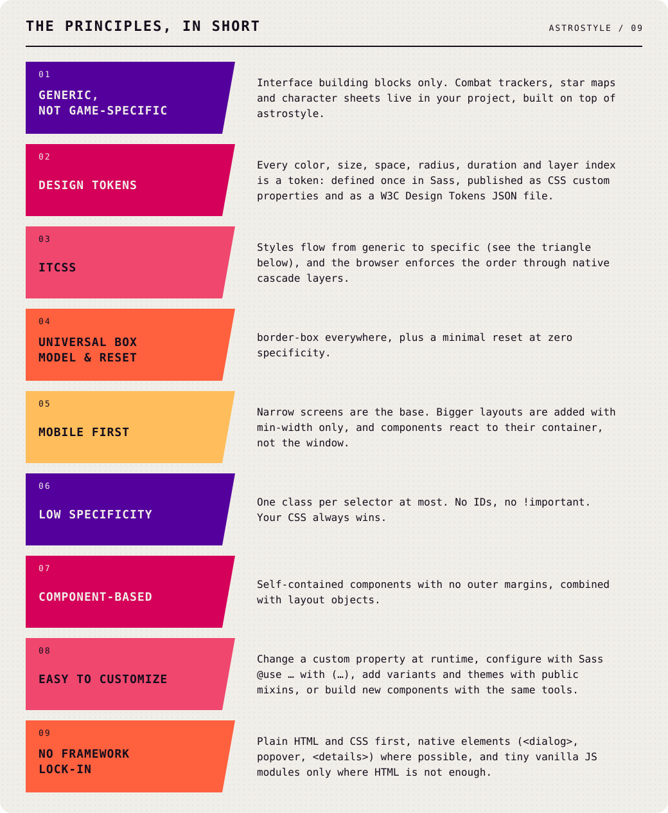
</p>

<details>
<summary>Text version of the principles</summary>

| | Principle | What it means |
| --- | --- | --- |
| 🧩 | **Generic, not game-specific** | Interface building blocks only. Combat trackers, star maps and character sheets live in your project, built on top of astrostyle. |
| 🎛️ | **Design tokens** | Every color, size, space, radius, duration and layer index is a token: defined once in Sass, published as CSS custom properties and as a W3C Design Tokens JSON file. |
| 🔻 | **ITCSS** | Styles flow from generic to specific (see the triangle below), and the browser enforces the order through native cascade layers. |
| 📦 | **Universal box model & reset** | `border-box` everywhere, plus a minimal reset at zero specificity. |
| 📱 | **Mobile first** | Narrow screens are the base. Bigger layouts are added with `min-width` only, and components react to their container, not the window. |
| 🪶 | **Low specificity** | One class per selector at most. No IDs, no `!important`. Your CSS always wins. |
| 🧱 | **Component-based** | Self-contained components with no outer margins, combined with layout objects. |
| 🎨 | **Easy to customize** | Change a custom property at runtime, configure with Sass `@use … with (…)`, add variants and themes with public mixins, or build new components with the same tools. |
| 🚫 | **No framework lock-in** | Plain HTML and CSS first, native elements (`<dialog>`, popover, `<details>`) where possible, and tiny vanilla JS modules only where HTML is not enough. |

</details>

<p align="center">
  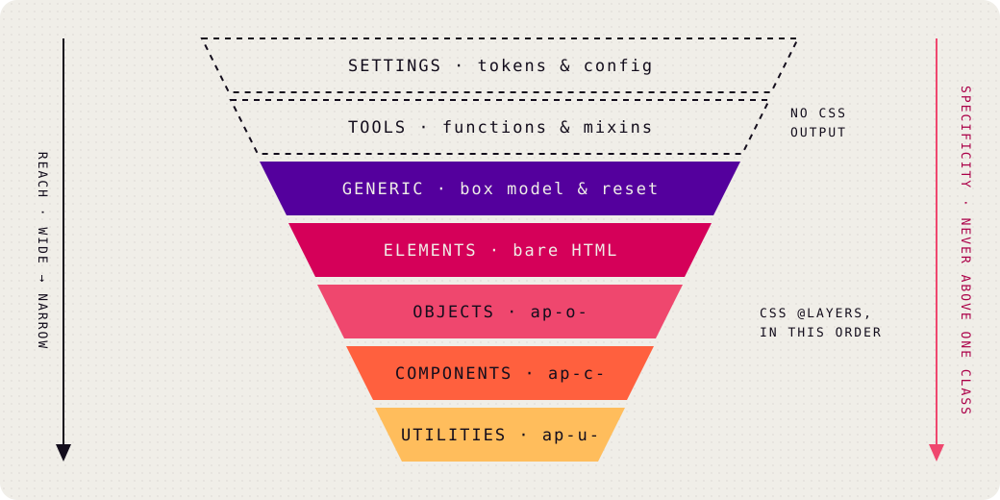
</p>

<br>

## 

The house rules, illustrated. Each image has an expandable text version below it.

### / Sass & ITCSS layers /

<p align="center">
  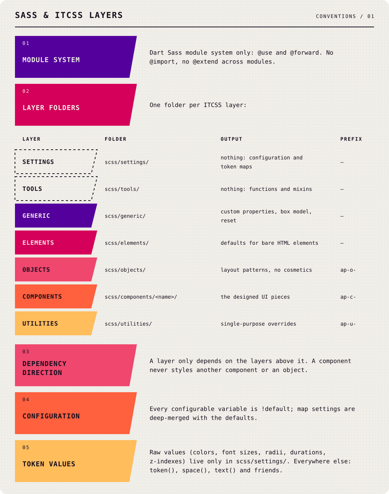
</p>

<details>
<summary>Text version of Sass &amp; ITCSS layers</summary>

- Dart Sass module system only: `@use` and `@forward`. No `@import`, no `@extend` across modules.
- One folder per ITCSS layer:

  | Layer | Folder | Outputs | Class namespace |
  | --- | --- | --- | --- |
  | Settings | `scss/settings/` | nothing: configuration and token maps | — |
  | Tools | `scss/tools/` | nothing: functions and mixins | — |
  | Generic | `scss/generic/` | custom properties, box model, reset | — |
  | Elements | `scss/elements/` | defaults for bare HTML elements | — |
  | Objects | `scss/objects/` | layout patterns, no cosmetics | `ap-o-` |
  | Components | `scss/components/<name>/` | the designed UI pieces | `ap-c-` |
  | Utilities | `scss/utilities/` | single-purpose overrides | `ap-u-` |

- A layer only depends on the layers above it. A component never styles another component or an object.
- Every configurable variable is `!default`; map settings are deep-merged with the defaults.
- Raw values (colors, font sizes, radii, durations, z-indexes) live **only** in `scss/settings/`. Everywhere else: `token()`, `space()`, `text()` and friends.

</details>

### / Selectors & naming /

<p align="center">
  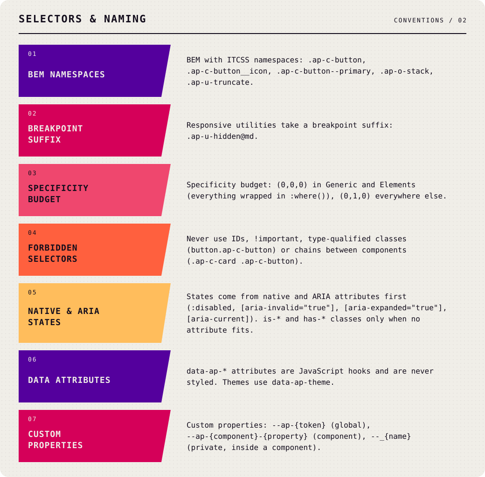
</p>

<details>
<summary>Text version of Selectors &amp; naming</summary>

- BEM with ITCSS namespaces: `.ap-c-button`, `.ap-c-button__icon`, `.ap-c-button--primary`, `.ap-o-stack`, `.ap-u-truncate`.
- Responsive utilities take a breakpoint suffix: `.ap-u-hidden@md`.
- Specificity budget: `(0,0,0)` in Generic and Elements (everything wrapped in `:where()`), `(0,1,0)` everywhere else.
- Never use IDs, `!important`, type-qualified classes (`button.ap-c-button`) or chains between components (`.ap-c-card .ap-c-button`).
- States come from native and ARIA attributes first (`:disabled`, `[aria-invalid="true"]`, `[aria-expanded="true"]`, `[aria-current]`). `is-*` and `has-*` classes only when no attribute fits.
- `data-ap-*` attributes are JavaScript hooks and are never styled. Themes use `data-ap-theme`.
- Custom properties: `--ap-{token}` (global), `--ap-{component}-{property}` (component), `--_{name}` (private, inside a component).

</details>

### / Responsive /

<p align="center">
  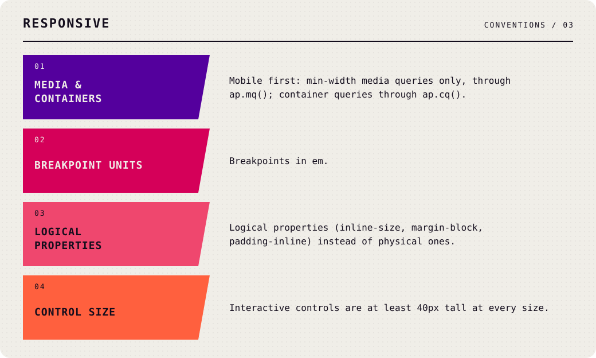
</p>

<details>
<summary>Text version of Responsive</summary>

- Mobile first: `min-width` media queries only, through `ap.mq()`; container queries through `ap.cq()`.
- Breakpoints in `em`.
- Logical properties (`inline-size`, `margin-block`, `padding-inline`) instead of physical ones.
- Interactive controls are at least 40px tall at every size.

</details>

### / Components /

<p align="center">
  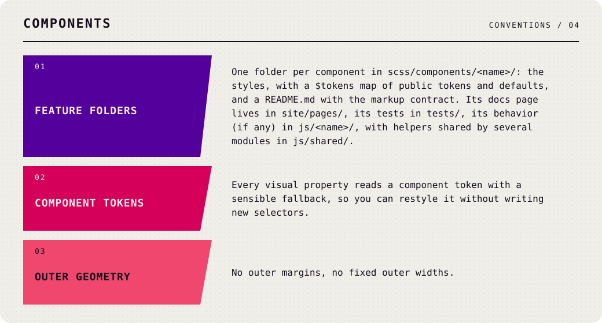
</p>

<details>
<summary>Text version of Components</summary>

- One folder per component in `scss/components/<name>/`: the styles, with a `$tokens` map of public tokens and defaults, and a `README.md` with the markup contract. Its docs page lives in `site/pages/`, its tests in `tests/`, its behavior (if any) in `js/<name>/`, with helpers shared by several modules in `js/shared/`.
- Every visual property reads a component token with a sensible fallback, so you can restyle it without writing new selectors.
- No outer margins, no fixed outer widths.

</details>

### / JavaScript /

<p align="center">
  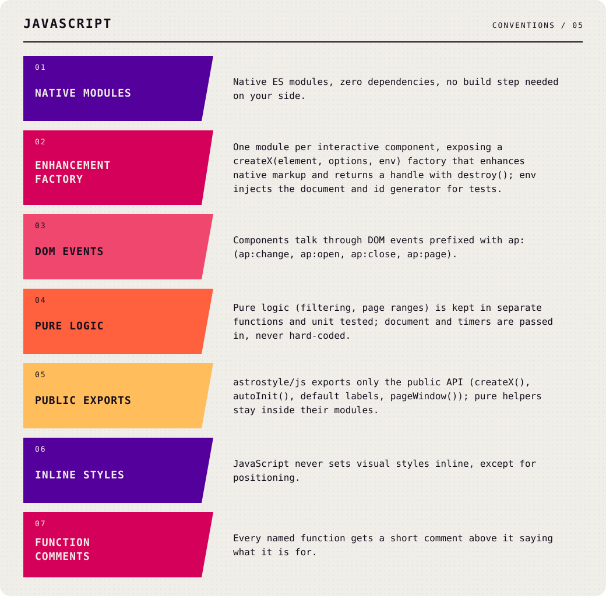
</p>

<details>
<summary>Text version of JavaScript</summary>

- Native ES modules in plain JavaScript, zero dependencies, no build step needed on your side; the types come as generated declarations.
- One module per interactive component, exposing a `createX(element, options, env)` factory that enhances native markup and returns a handle with `destroy()`; `env` injects the document and id generator for tests.
- Components talk through DOM events prefixed with `ap:` (`ap:change`, `ap:open`, `ap:close`, `ap:page`, `ap:select`).
- Pure logic (filtering, page ranges) is kept in separate functions and unit tested; `document` and timers are passed in, never hard-coded.
- `astrostyle/js` exports only the public API (`createX()`, `autoInit()`, default labels, `pageWindow()`); pure helpers stay inside their modules.
- JavaScript never sets visual styles inline, except for positioning.
- Every named function gets a short comment above it saying what it is for, written as JSDoc with `@param` types: the sources stay plain JavaScript, `tsc` checks them (`checkJs`, strict) and generates the `.d.ts` files.

</details>

### / Repository /

<p align="center">
  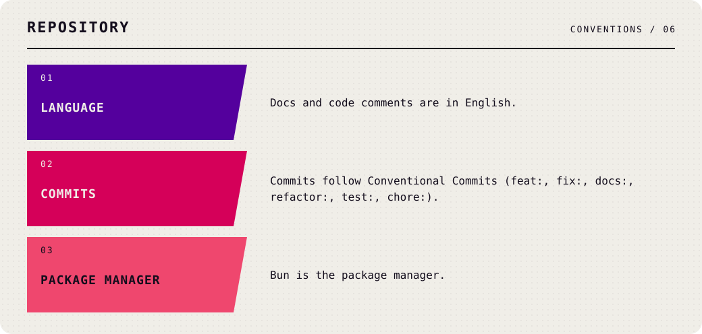
</p>

<details>
<summary>Text version of Repository</summary>

- Docs and code comments are in English.
- Commits follow Conventional Commits (`feat:`, `fix:`, `docs:`, `refactor:`, `test:`, `chore:`).
- Bun is the package manager.

</details>

<br>

## 

How a change travels from an idea to `master`, and from `master` to npm on the weekly release train.

<br>

### / Setup /

```sh
git clone https://github.com/Cantilux/astrostyle.git
cd astrostyle
bun install
```

| Command | What it does |
| --- | --- |
| `bun run dev` | Serves the docs at <http://localhost:4321/demo.html> and rebuilds and reloads the page on every change in `scss/`, `site/` or `scripts/`; Sass errors appear in the page |
| `bun run build` | Builds `dist/`: the full bundle (`astrostyle.css`), `core.css`, one file per component in `components/` (each also `.min`), `fonts.css` and `tokens.json`, then type-checks `js/` and writes its declarations to `dist/types/` |
| `bun run docs:build` | Builds the documentation site into `_site/` (serve it over HTTP, e.g. with `bun run dev`: JavaScript modules do not run from `file://`) |
| `bun run test` | Runs every `tests/**/*.test.mjs` with `node --test` |
| `bun run test:browser` | Local only, not in CI: runs the interactive components in Chromium, Firefox and WebKit (`tests/browser/*.browser.mjs`, Playwright); install the browsers once with `bunx playwright install chromium firefox webkit`, pick some with `BROWSERS=chromium,webkit` |
| `bun run lint` | Stylelint on `scss/` plus a Prettier check |
| `bun run format` | Rewrites files with Prettier (Markdown is left as written) |
| `bun run check:package` | After a build: checks what npm would publish, that `@use 'pkg:astrostyle'` compiles, that every exported path (`astrostyle/css/button`, `astrostyle/js`…) resolves and that a TypeScript consumer type-checks the public API |
| `bun run changeset` | Records a change for the next release |
| `bun run release:version` | Applies pending changesets: new version and changelog entry (the release train runs it, not people) |

<br>

### / Making a change /

1. **Pick or open an issue.** The roadmap is [#94](https://github.com/Cantilux/astrostyle/issues/94), in the order of its [milestones](https://github.com/Cantilux/astrostyle/milestones).
2. **Branch from `master`** (from `hotfix` for an urgent fix, see Releasing). `master` is protected: nobody pushes to it directly, maintainers included; only the release train adds its version and merge-back commits. Name the branch after the kind of change, e.g. `feat/button`, `fix/reset-svg`, `docs/tokens`.
3. **Commit with Conventional Commits** (`feat:`, `fix:`, `docs:`, `refactor:`, `test:`, `chore:`, `ci:`) and reference the issue (`Refs #5`).
4. **Add a changeset** with `bun run changeset` when the change affects what users get (styles, tokens, classes, JavaScript). Pick the bump from the public contract:

   | Bump | When |
   | --- | --- |
   | `patch` | Fixes that keep every token, class and option working as before |
   | `minor` | New components, tokens, variants or options |
   | `major` | Renamed or removed tokens, classes, mixins or options (while in `0.x`: `minor`) |

5. **Open a Pull Request.** CI runs lint, tests, the build, the package check and the docs build; merging needs a green CI. Run `bun run test:browser` yourself when you touch a JavaScript module: CI does not run it.

<br>

### / Releasing /

Releases leave on a schedule, never from a laptop. Merge pull requests into `master` whenever they are ready, each with its changeset; nobody bumps versions by hand.

| Branch | Role |
| --- | --- |
| `master` | Work for the next scheduled release |
| `release` | What is on npm; only the release train moves it, and every push to it publishes |
| `hotfix` | Starts from `release`; urgent fixes merged here ship at once |

1. **Every Tuesday around 12:00 (Rome time)** the **Release train** workflow takes `master`. With no pending changesets it stops. Otherwise it runs `bun run release:version` (new version, `CHANGELOG.md` entry), lint, tests, build and the package check, pushes the `chore: release x.y.z` commit to `master`, fast-forwards `release` to it and moves `hotfix` there too.
2. **The push to `release`** starts the **Release** workflow: it sees a version npm does not have yet, runs the checks again, publishes with npm trusted publishing (with provenance) and tags `vX.Y.Z`.
3. **Hotfix:** open a pull request into `hotfix` with a `patch` changeset (CI rejects `minor` and `major` there) and merge it. The train releases `hotfix` right away the same way, then merges it back into `master`; if that merge conflicts, it opens a pull request to resolve, and the Tuesday train waits for it. Never land the same fix in `master` too: it gets there through the merge back.

The train refuses to release when `release` has commits its source branch lacks, and a branch that moved while it ran makes it stop; it is safe to run again. Its pushes use the `RELEASE_DEPLOY_KEY` deploy key, which may bypass the branch rules of `master`, `hotfix` and `release`.

Run `bun run check:package` to see exactly what npm would receive.

<br>

## 

The astrostyle code is released under the [MIT license](LICENSE). Take it, fork it, fly it. The font files in `fonts/` are not: each keeps its own license, listed in [`fonts/README.md`](fonts/README.md).

The ASTROPRISMA look it reproduces (palette, typography choices and graphic motifs from the Creator Kit Design Guide) is used under the [ASTROPRISMA Third Party License](https://www.astroprisma.com/license). ASTROPRISMA is copyright Camila Mera and Crescent Chimera. Apart from the "Compatible with ASTROPRISMA" logo below, which the license allows, astrostyle uses no ASTROPRISMA or Crescent Chimera logos.

<p align="center">
  <picture>
    <source media="(prefers-color-scheme: dark)" srcset=".github/assets/compatible-with-astroprisma-white.png">
    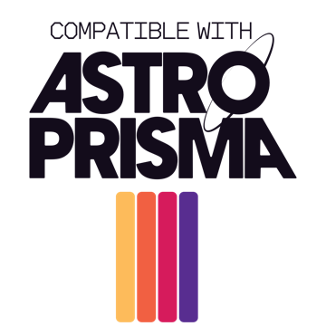
  </picture>
</p>


